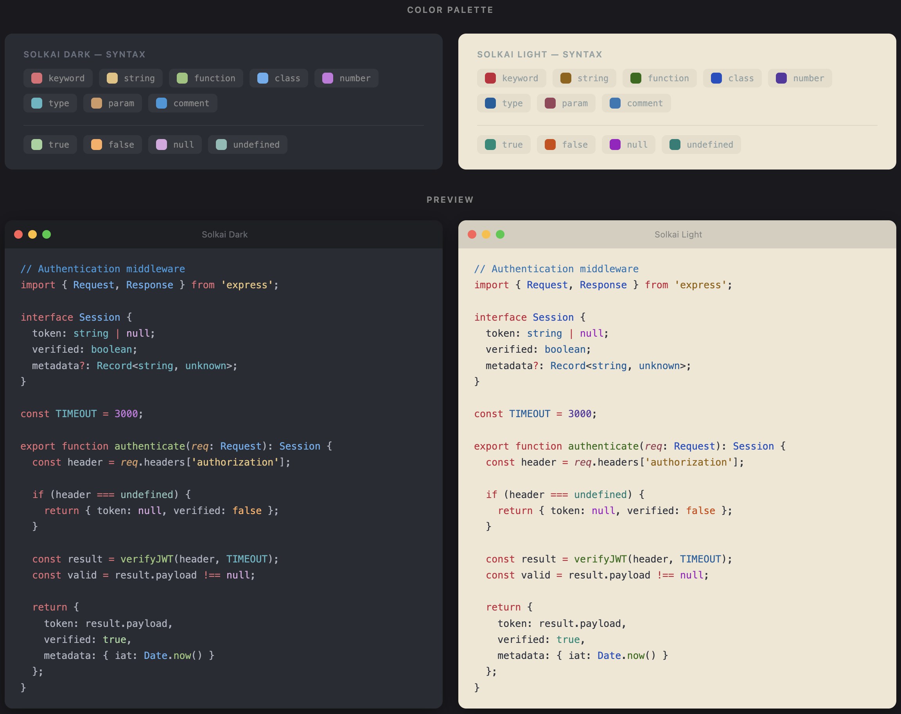

# Solkai Theme

A dark/light theme set for VS Code.



**Solkai Dark** — One Monokai base with custom boolean/null/undefined highlighting.

**Solkai Light** — Warm cream background (Solarized-inspired) with One Monokai syntax colors adapted for light mode. No more eye-burning white backgrounds.

## Features

- Custom semantic highlighting for `true`, `false`, `null`, `undefined`
- Dark/Light pair designed together — consistent color logic across both
- Light theme uses a warm cream background instead of harsh white
- Supports auto-switching with `window.autoDetectColorScheme`

## Syntax Palette

### Dark

| Role        | Color | Hex       |
| ----------- | ----- | --------- |
| Keyword     | 🔴    | `#e06c75` |
| String      | 🟡    | `#e5c07b` |
| Function    | 🟢    | `#98c379` |
| Class       | 🔵    | `#61afef` |
| Number      | 🟣    | `#c678dd` |
| Type        | 🩵    | `#56b6c2` |
| Comment     | 💙    | `#3498DB` |
| `true`      | 🌿    | `#a2d39c` |
| `false`     | 🟠    | `#ffac5f` |
| `null`      | 💜    | `#d8a7e0` |
| `undefined` | 🌊    | `#89bbb6` |

### Light

| Role        | Color | Hex       |
| ----------- | ----- | --------- |
| Keyword     | 🔴    | `#C5243A` |
| String      | 🟤    | `#956300` |
| Function    | 🌲    | `#2C6A0E` |
| Class       | 🔷    | `#1B4FC2` |
| Number      | 💠    | `#5538A0` |
| Type        | 🔹    | `#0A5E9E` |
| Comment     | 💙    | `#2878B5` |
| `true`      | 🌿    | `#008A78` |
| `false`     | 🟠    | `#D04800` |
| `null`      | 💜    | `#9E18C2` |
| `undefined` | 🌊    | `#0E7D75` |

## Auto Dark/Light Switching

Add to your `settings.json`:

```json
{
	"window.autoDetectColorScheme": true,
	"workbench.preferredDarkColorTheme": "Solkai Dark",
	"workbench.preferredLightColorTheme": "Solkai Light"
}
```

## Credits

- [One Monokai](https://github.com/azemoh/vscode-one-monokai) by Joshua Azemoh (MIT). Solkai Dark adapts its UI and syntax colors; Solkai Light also adapts its syntax rules.
- [Solarized Light for VS Code](https://github.com/microsoft/vscode/tree/1.109.5/extensions/theme-solarized-light) (MIT). Solkai Light takes inspiration from its warm palette.
- [Bluloco Light](https://github.com/uloco/theme-bluloco-light) by uloco. Solkai Light adapts its UI color configuration. The [upstream revision reviewed](https://github.com/uloco/theme-bluloco-light/blob/5fe02401e9b49742ff5c75c06e3d2eb465e46724/LICENSE) is licensed under GNU LGPL v3, not MIT.

## Licensing

See [LICENSE](./LICENSE) for Solkai's original material and [Third-party notices](./THIRD-PARTY-NOTICES.md) for upstream credits, license texts, and the outstanding release review for Bluloco-derived material.
